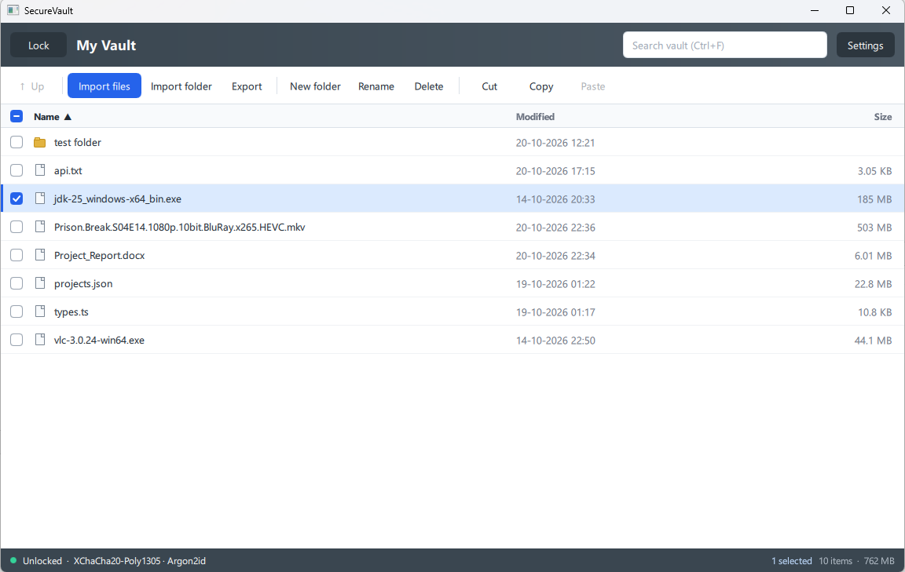
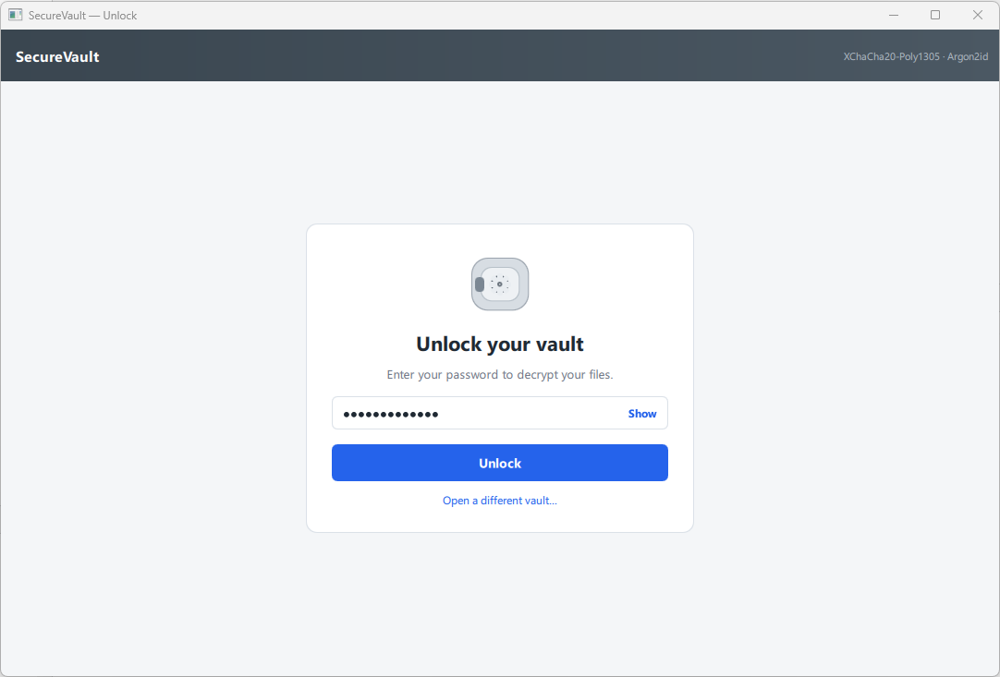
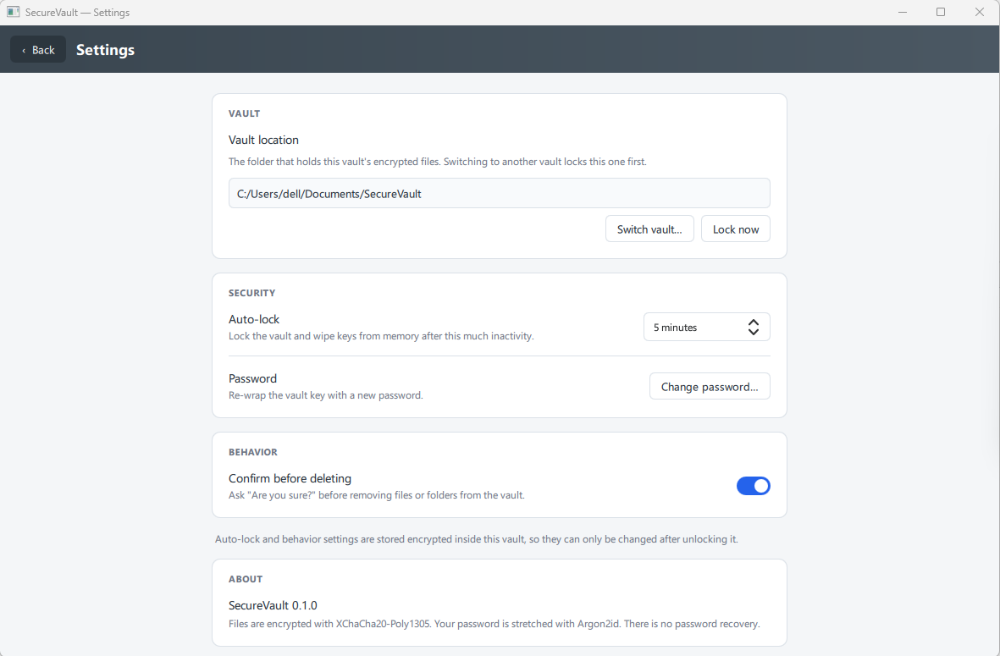
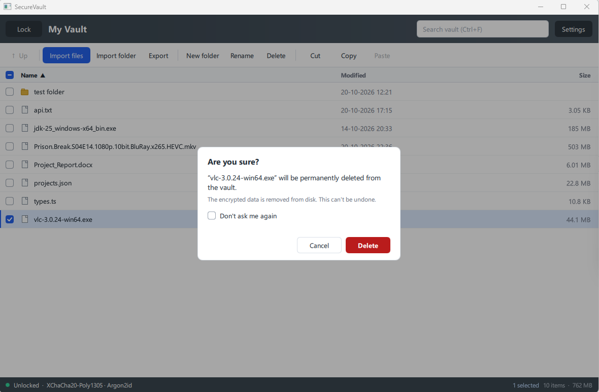

# SecureVault

[](LICENSE)


A desktop encrypted file vault for Windows and Linux.

Files on disk are ciphertext with obfuscated names. Real names, folders, and contents are only visible after you unlock with your password.

**C++20 · Qt 6 QML · libsodium** (plus Windows CNG / Linux OpenSSL for AES-GCM) · one codebase for Windows and Linux.



> **Lost password = lost vault.** There is no recovery.

## Screenshots

| Unlock | Settings | Delete confirmation |
| --- | --- | --- |
|  |  |  |

## Features

- Create or unlock a vault with a password (Argon2id)
- Choose file encryption at create time, or change it later in Settings (re-encrypts every file): **XChaCha20-Poly1305** (default) or **AES-128/192/256-GCM**
- Browse folders, search, sort, rename, and create folders
- Import and export files or whole folders (drag-and-drop supported)
- Copy / cut / paste **inside** the vault and **with** File Explorer (and the Linux file manager)
  - Copy keeps the original
  - Cut moves (paste into the vault encrypts, then removes the source; paste to the desktop decrypts, then removes it from the vault)
- Multi-select with row checkboxes
- Delete confirmation, with an optional “don’t ask again” per vault
- Open a file: decrypts a temp copy and launches the system handler
- Auto-lock after idle time; lock wipes keys and temp files from memory/disk
- Change password without re-encrypting every file
- Settings only after unlock — auto-lock and delete confirmation live **inside** the encrypted index

## Threat model

**Protects against**

- Someone copying the vault folder off disk, a USB stick, or a backup
- Casual inspection of filenames (the index is encrypted; blobs have hex names)

**Does not protect against**

- Malware, keyloggers, or a compromised OS
- Memory dumps while the vault is unlocked
- Forgetting the password

This is encryption at rest, not a kernel disk encryptor like BitLocker or VeraCrypt. Unlocking decrypts data **in the app**. Opening a file writes a plaintext temp copy; that copy is wiped on lock.

## How encryption works

Password → **Argon2id** → wrapping key → unwraps a random 256-bit master key.

The wrapping key and `index.enc` always use **XChaCha20-Poly1305 AEAD**, so `vault.header` stays 112 bytes and existing vaults still open. **File blobs** use the cipher you pick:

| Method | Notes |
| --- | --- |
| XChaCha20-Poly1305 | Default. libsodium secretstream. |
| AES-128-GCM | 128-bit key, 10 rounds. NIST AES. |
| AES-192-GCM | 192-bit key, 12 rounds. NIST AES. |
| AES-256-GCM | 256-bit key, 14 rounds. NIST AES. |

AES only has those three key sizes. Products that advertise “AES-512” or “AES-1024” are not standard AES; they are not offered here.

| On disk | What it is |
| --- | --- |
| `vault.header` | Magic `SVLT`, version, selected file cipher, Argon2id parameters, salt, wrapped master key |
| `index.enc` | AEAD-encrypted JSON tree (names, dates, sizes, per-vault settings) |
| `blobs/ab/cd/<id>` | Per-file ciphertext. v1 blobs are XChaCha secretstream; v2 blobs record their own cipher so a mid-switch crash is recoverable |

Changing the password re-wraps the master key. File blobs are not rewritten. Changing the **file cipher** decrypts each file and writes a new blob.

A later version can switch to a single `.vault` container (`ContainerBlobStore`) without changing the UI. That backend is stubbed, not wired up.

Default vault location: `Documents/SecureVault`.

## Using the app

1. Create a vault with a password of at least 8 characters, or unlock an existing one. New vaults can pick XChaCha20-Poly1305 or AES-128/192/256-GCM for file contents.
2. **Open a different vault…** on the unlock screen picks another folder. **Settings → Switch vault…** (while unlocked) locks the current vault first, then points at a new folder.
3. Import files, drag them in, or paste from the file manager. Use row checkboxes for multi-select.
4. Double-click a file to open it. **Lock** (or wait for auto-lock, 5 minutes by default) to wipe keys and temp files.
5. Settings is only reachable while unlocked. Auto-lock, “confirm before deleting”, and the file-cipher picker are stored with that vault (the cipher lives in `vault.header`; the rest is in the encrypted index). Changing the cipher re-encrypts every file. Only the last-used vault **path** is stored in plain `QSettings`, because the app needs it before unlock.

## Build

### Requirements

- Qt 6.10+ (developed with **6.12**) with Quick
- CMake 3.16+
- C++20 compiler (MSVC 2022 on Windows, GCC or Clang on Linux)
- Linux: OpenSSL (`libcrypto`) for AES-GCM. Windows uses the built-in CNG `bcrypt` library instead.

Official [libsodium](https://github.com/jedisct1/libsodium) **1.0.20-RELEASE** is a git submodule at `third_party/libsodium`. This repo only stores the pin and [`third_party/sodium.cmake`](third_party/sodium.cmake). Clone with submodules:

```bash
git clone --recurse-submodules <this-repo>
# existing clone:
git submodule update --init --recursive
```

### Qt Creator

After the submodule is initialized, open `CMakeLists.txt`, pick a Desktop Qt 6 kit (MSVC or GCC), Configure, Build. Run the `appSecureVault` target.

### Command line (Windows)

```bat
git submodule update --init --recursive
call "C:\Program Files\Microsoft Visual Studio\18\Community\VC\Auxiliary\Build\vcvars64.bat"
cmake -S . -B build -G "NMake Makefiles JOM" -DCMAKE_PREFIX_PATH=C:/Qt/6.12.0/msvc2022_64
cmake --build build
```

### Command line (Linux)

```bash
git submodule update --init --recursive
cmake -S . -B build -DCMAKE_PREFIX_PATH=/path/to/Qt/6.12.0/gcc_64
cmake --build build
```

## Packaging

- **Windows:** build Release, then `packaging/windows-deploy.ps1` (`windeployqt --qmldir`).
- **Linux:** `packaging/linux-deploy.sh` (uses `linuxdeployqt` if installed).

macOS is the same source; v1 does not ship notarized packages.

## Project layout

```
SecureVault/
├── main.cpp                 # App entry, sodium init, QML context
├── src/
│   ├── app/                 # Unencrypted app settings (last vault path)
│   ├── crypto/              # Argon2id, XChaCha, BLAKE2b, AES-GCM streams
│   └── vault/               # Header, index, blob store, session
├── third_party/             # sodium.cmake + libsodium submodule pin
├── *.qml                    # Qt Quick UI
├── docs/images/             # README screenshots
└── packaging/
```

## Status

Early **v0.1** folder vault. Useful as a personal encrypted file browser; not audited. Do not treat it as a substitute for full-disk encryption or a reviewed password manager.

## License

SecureVault is released under the [MIT License](LICENSE).

It uses third-party libraries under their own licenses:

- [Qt 6](https://www.qt.io/licensing): LGPLv3 (open-source edition)
- [libsodium](https://github.com/jedisct1/libsodium): ISC
